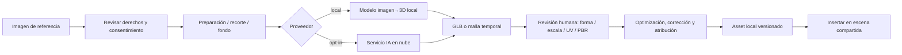

# IA Studio: de imagen de referencia a mobiliario 3D

**Estado:** fase futura optativa, no funcional actualmente. El usuario decide si ejecutar local o solicitar proveedor externo.

## Flujo principal

## Ejemplo de usuario
1. Añade foto de sofá a tablero de referencias.
2. Registra fuente, autor conocido, términos de uso y si tiene permiso para generar derivados.
3. Solicita modelo 3D. Se muestra si será procesamiento local o transferencia a proveedor remoto, costo esperado y datos enviados.
4. Se recibe malla preliminar, NO geometría de fabricación validada.
5. Revisa orientación, alto/ancho/fondo con medida real aportada; corrige escala manualmente.
6. Inspecciona topología, triángulos, UV, normal, materiales y posibles defectos.
7. Guarda asset GLB+metadatos; lo arrastra a Modelado; en Render aplica materiales.
8. Reutiliza en otro proyecto sin ejecutar IA de nuevo.

## Contrato de proveedores (propuesta)
`capabilities()`, `estimate(inputs)`, `generate(request, cancelToken)`, `status(jobId)`, `download(jobId)`, `metadata(jobId)`. Permisos por proveedor y proyectos; cancelación, reintento y archivos temporales limpiables. Los outputs nunca se aplican sin confirmación.

## Proveedores
Candidatos a evaluar, no integrados: Hunyuan3D/servicios Tencent, modelos open-weight compatibles, backends locales (si recursos GPU bastan) y conectores remotos. Verificar por modelo: licencia de pesos, usos comerciales, dependencias, VRAM, calidad, privacidad y costos. **Open-weight no equivale automáticamente a software libre.**

## Seguridad, derechos y privacidad
- Nunca subir fotos de clientes, hogares o personas a nube sin permiso informado.
- Evitar incluir credenciales, coordenadas, metadatos privados o información sensible en solicitudes.
- No presuponer derechos de copiar muebles de marcas ni fotos de sitios web.
- Metadatos: proveedor, versión, fecha, prompt si se consiente, imagen fuente si legalmente almacenable, atribución, licencia, dimensiones, estado de revisión.
- Etiquetar `generado`, `revisado`, `apto_para_visualización` y `apto_para_fabricación` (último requiere validación profesional independiente).
- No presentar estimaciones de volumen/materia prima precisas desde una malla AI sin medirla.

## Módulo Hermes/MCP (opcional)
Conector bajo lista de comandos autorizados, permisos, trazabilidad por evento, undo/redo y vista previa; ninguna IA debe ejecutar comandos del sistema indiscriminadamente. Las acciones geométricas deben pasar por la misma API transaccional de la aplicación.

## Demo que habilita siguiente fase
Un sofá de referencia → GLB → inspección / medida real → catálogo → inserción/edición y render. Registrar tiempo, tamaño, defectos y licencias del caso de prueba.
