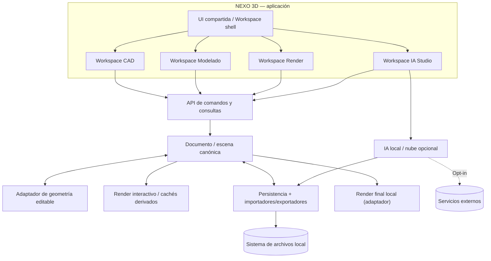
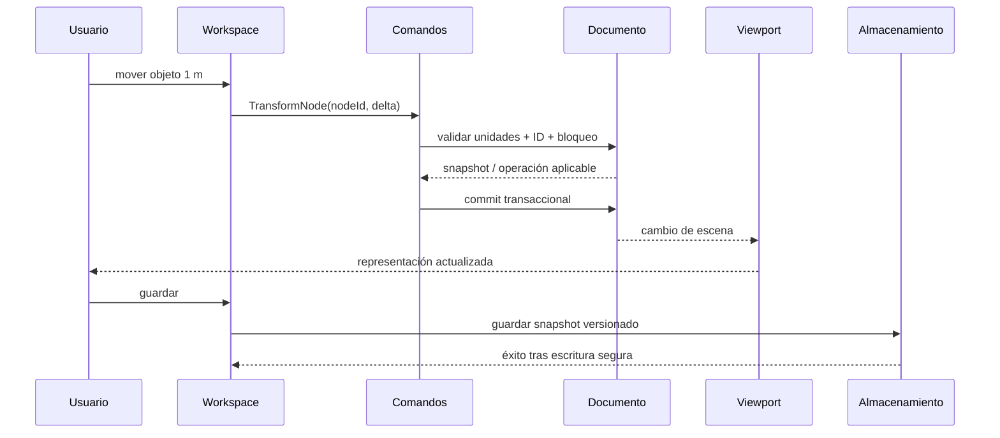

# Arquitectura técnica — NEXO 3D

**Estado:** objetivos de arquitectura APROBADOS; tecnologías PROPUESTAS. Ningún motor se considera integrado antes de PoC, revisión de licencia y pruebas. Ver [ADR](adr/README.md).

## 1. Arquitectura conceptual



**Regla:** ni CAD, ni Modelado, ni Render mantienen copias maestras independientes del proyecto. El visualizador produce derivados. Cualquier mutación persistente entra mediante comandos validados sobre el documento.

## 2. Capas
| Capa | Responsabilidad | No debe hacer |
| --- | --- | --- |
| UI Shell | Menús, selección de workspace, accesibilidad, atajos | Modificar archivos arbitrariamente |
| UI de workspaces | Herramientas especializadas, inspector, interacciones | Mantener otro modelo de verdad |
| Commands / Queries | Validar entrada, ejecutar transacciones, undo/redo, eventos | Depender directamente de React |
| Scene / Document | IDs, jerarquía, unidades, semántica, referencias, schema | Incluir recursos GPU como fuente de verdad |
| Geometry adapter | Sketch, sólidos, booleans, push/pull y tolerancias | Guardar un formato privativo como único modelo |
| Renderer viewport | Dibujar meshes/luces/cámara y picking | Persistir caches de GPU como geometría editable |
| Render final | Exportar snapshot de escena, trabajar con proceso aislado | Cambiar documento sin comando |
| IO & Asset Store | Serialización, importación, hashes, referencias y recuperación | Ejecutar contenido embebido no confiable |
| Plugin / IA | Capacidades optativas bajo permisos | Requerir servicios externos para apertura/edición |

## 3. División del código (propuesta de monorepo)
```text
apps/
  desktop/            # shell nativo multiplataforma (evaluar Tauri)
  web/                # shell de navegador cuando se valide
packages/
  domain/             # entidades, tipos, schema, validación
  commands/           # acciones transaccionales, undo/redo
  geometry/           # interfaces CAD/B-Rep/sketch; implementaciones adaptables
  renderer-viewport/  # viewport WebGL/WebGPU con fallback
  workspace-cad/      # herramientas CAD y documentación
  workspace-model/    # herramientas 3D / manipulación
  workspace-render/   # UI materiales, entornos, luces, cámaras
  workspace-ai/       # referencias, procesos y asset review
  storage/            # serialización, repositorio de assets y migraciones
  import-export/      # glTF/GLB y posteriores
  plugin-sdk/          # API versionada, permisos, manifest
services/
  render-local/       # adaptador al render externo, sin obligar cloud
  ai-adapters/        # opcional local/remoto, bajo consentimiento
docs/
  adr/
tests/
  fixtures/
```
Esta estructura describe fronteras. No crear carpetas vacías ni prometer binarios cuando aún no hay código.

## 4. Plataforma y ejecución
**Estrategia:** frontend reusable (evaluar React/TypeScript), contenedor escritorio (evaluar Tauri), geometría portable (evaluar Rust/WebAssembly) y visor con API estándar web. La integración de código fuente Hew está **pendiente** de evaluación.

- **Windows, Linux, macOS:** interfaz común; file dialogs, filesystem, procesos y aceleración GPU mediante adapters nativos.
- **Web posterior:** navegador soportado según WebAssembly/Canvas/WebGL/WebGPU. Persistencia dentro del sandbox del navegador; import/export mediante permisos y diálogos. No presuponer RTX/OptiX ni filesystem libre.
- **Sin conexión:** app y dependencias de edición local instalables; redes desactivadas por defecto excepto comprobaciones explícitamente aceptadas.
- **Render final:** pipeline local separable del visor, por ejemplo un Blender/Cycles externo; render cloud es backend reemplazable.

## 5. Modelo de datos y límites de autoridad
Consultar [PROJECT_FORMAT.md](PROJECT_FORMAT.md). Categorías:
- `Project`: schemaVersion, metadata, units, preferencias documentales.
- `Node`: UUID, nombre, parentId, transform, visibilidad, layer/tag, componentRef, tipo.
- `Geometry`: sketch paramétrico/B-Rep/mesh, con representación derivada de viewport y tolerancias.
- `Material`: PBR, texturas por hash/ruta interna, UV, color space.
- `Lighting`/`Camera`/`Environment`: parámetros físicos/versionados y presets.
- `Semantics`: muro, losa, puerta u objeto libre, si aplica; clasificaciones no se infieren con certeza de malla.
- `Asset`: archivo y metadatos de procedencia/licencia.
- `ChangeHistory`: secuencia temporal de comandos validada para undo/redo; el formato definitivo se decidirá por prueba.

**Invariante:** el estado del documento es independiente de la GPU, del renderer final y del proveedor de IA.

## 6. Flujo de cambios


**Contratos mínimos:** `execute(command) -> Result<revision, errors>`, `query(documentId, selector)`, `subscribe(revision)`, `serialize(snapshot)`, `deserialize` y `migrate(schemaVersion)`. Son interfaces deseadas, aún no API publicada.

### Semántica de comandos
1. Validación de permisos, unidad, rango y existencia de ID.
2. Precondición por revisión para evitar aplicar sobre estado inesperado.
3. Resultado determinista sobre estado canónico.
4. Undo/redo definido por inversa o snapshot, sin reutilizar IDs borrados accidentalmente.
5. Eventos de invalidación de cache para renderer, vistas y cotas.

## 7. Integración CAD y geometría
Los planos son una **vista del documento** donde sea posible. Geometría 2D puede existir de forma autónoma; si una polilínea se convierte en muro debe tener semántica, nivel y propiedades explícitas. El cambio de elevación / corte deriva de objetos coherentes, no de reconstrucción automática infalible de una malla importada.

Una arquitectura híbrida podría usar sketch paramétrico + B-Rep para geometría editable y mesh triangulada para viewport. Elección de kernel pendiente (ver [ENGINE_EVALUATION](ENGINE_EVALUATION.md)). Evitar construir booleanas desde triángulos sin plan para exactitud, tolerancias y exportación.

## 8. Render: dos rutas, no dos proyectos
**Viewport interactivo:** rapidez, navegación y preview; degradación de calidad posible según GPU. **Render final:** fotografía/animación basada en un snapshot de escena reproducible y recursos locales. La salida de Blender/Falcor/otro backend no reescribe geometría canónica. Ver [RENDERING.md](RENDERING.md).

## 9. Gestión de archivos y errores
- Guardado: escritura temporal → flush/verificación cuando posible → reemplazo atómico → backup periódico; no depender solo de autosave.
- Importación: parser aislado/limitado en tamaño, rutas saneadas; errores estructurados por asset.
- Cambios de schema: versionado, migración y fixture de versiones antiguas.
- Referencias externas: preferencias explícitas de empaquetar vs vincular; avisos de archivos ausentes.
- Plugins: capacidades declaradas, permisos por proyecto, versionado y ejecución controlada.

## 10. Seguridad, rendimiento y observabilidad
No telemetría obligatoria; diagnósticos locales optativos. Métricas de desarrollo: escena conocida, hardware, RAM/VRAM, tiempo de carga, FPS percentiles y estabilidad de round-trip. Guardar pruebas sin información privada. Modelos de amenaza: archivos maliciosos, scripts, desbordes por texturas, tokens en logs y escalada del adaptador de render.

## 11. Criterios para aprobar implementación
1. PoC en Windows y Linux, y al menos diseño verificable para macOS/web.
2. Tests AC-MVP-01/02/03.
3. Auditoría de dependencias, licencias y seguridad.
4. Mecanismos de migración y recuperación.
5. ADR nuevo cuando se escoja definitivamente kernel de geometría o backend interactivo.
