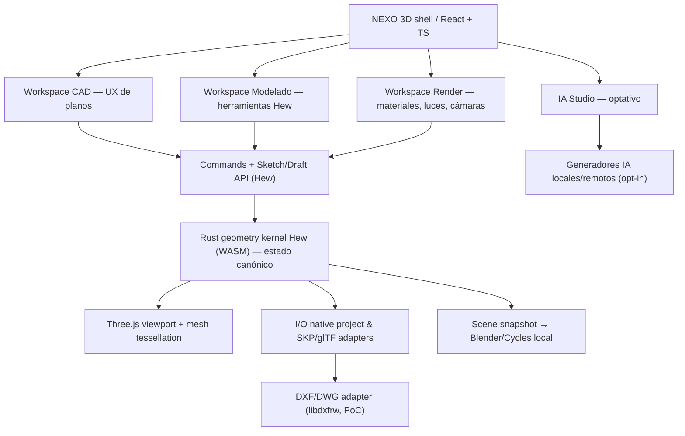

# Auditoría de reutilización open source — NEXO 3D

**Fecha:** 2026-10-13 · **Tipo:** inspección de repositorios/licencias/API y documentación (SIN build local ni benchmarking).  
**Objetivo:** escoger la base que permita **CAD 2D → Modelado 3D → Render** en una única app **AGPL-3.0-only**, offline-first, Windows/Linux/macOS y futura web, **sin reinventar lo ya construido**.

## Resultado ejecutivo

**Recomendación inicial:** evaluar NEXO 3D como **fork/adaptación de Hew** (ya usa Rust + WASM + React/TypeScript + Three.js + Tauri), antes de seguir creando motores e interfaces desde cero. Construir una superficie CAD 2D sobre su sistema de sketches/drafting e inferencias; para los formatos evaluar libdxfrw como adaptador y los importadores de Hew/OpenSKP. Integrar **Blender/Cycles como proceso de render final** controlado mediante un adaptador de escenas, en lugar de portar el motor de Blender. **IngeTrazo** sirve como referencia arquitectónica y candidato para reutilizaciones puntuales, pero trasladar toda su app Python/PySide6 a navegador implicaría trabajo considerable.

La fracción «80 % reutilización / 20 % integración» es **aspiracional, no estimación**: aún no sabemos cuánto trabajo exigirá incorporar CAD y render en Hew.

> Importante: NO se integró código de estos proyectos en este PR. Las observaciones corresponden a su código/documentación en los commits fijados abajo, no a resultados de pruebas de ejecución en nuestro hardware.

## 1. Repositorios inspeccionados y versiones fijadas

| Proyecto | Commit de auditoría | Lenguaje/UI observados | Licencia base observada | Decisión |
| --- | --- | --- | --- | --- |
| [Hew](https://github.com/hew3d/hew) | [f36661f](https://github.com/hew3d/hew/tree/f36661fb726253e501ef26a4d5fff3cc6381d814) | Rust/WASM; React/TypeScript; Three.js; Tauri | AGPL-3.0-only + excepción de API de plugins | **Candidato A para núcleo/modelador y shell** |
| [IngeTrazo](https://github.com/ingelibre/ingetrazo) | [759f4c6](https://github.com/ingelibre/ingetrazo/tree/759f4c65a579fecf544963842dfe1335a348ec4f) | Python; PySide6/Qt/OpenGL | GPL-3.0-or-later según encabezados/README | Referencia y código puntual, no shell primario web |
| [LibreCAD](https://github.com/LibreCAD/LibreCAD) | [06994d7](https://github.com/LibreCAD/LibreCAD/tree/06994d7ad41a04f0746c00c1d383e6ad4dd39e55) | C++17/Qt | **GPLv2, declarado en LICENSE** | **No incorporar código de la aplicación** a combinado AGPLv3 sin nuevo permiso/relicencia |
| [QCAD](https://github.com/qcad/qcad) | [4c830eb](https://github.com/qcad/qcad/tree/4c830eb4d80285ca64b1f2c2dc0987f729344126) | C++/Qt, API C++ y scripts ECMAScript | GPLv3 (con excepciones) | Candidato B para CAD específico; Qt→Web exige evaluación |
| [Blender](https://github.com/blender/blender) | [8da87e1](https://github.com/blender/blender/tree/8da87e153a1563f3509847dbfff82409f07bc2a8) | C/C++/Python; Cycles/EEVEE | GPLv3 como conjunto según README | **Proceso externo de render, no portar Cycles** |
| [libdxfrw](https://github.com/LibreCAD/libdxfrw) | [d68fb1e](https://github.com/LibreCAD/libdxfrw/tree/d68fb1ed937ad2a74a54f6208277ec10a1b031b0) | C++17 biblioteca DXF/DWG | **GPL-2.0-or-later** | Adaptador CAD a evaluar por separado |
| [OpenSKP Rust](https://github.com/hew3d/openskp) | [a6788af](https://github.com/hew3d/openskp/tree/a6788afa6386cfd4bc781998dca99c591b3fb069) | Rust, lector SKP y documentación | GPL-3.0 | Ruta natural con Hew; cobertura y escritor a validar |
| [OpenSKP Python](https://github.com/iamahsanmehmood/openskp) | [a8408f3](https://github.com/iamahsanmehmood/openskp/tree/a8408f3e7ca74162ccf015399bcfc72f55aad333) | Python/otros | MIT según metadatos repo | **Proyecto distinto** del OpenSKP Rust; usado por IngeTrazo |
| [OpenCascade.js](https://github.com/donalffons/opencascade.js) | [5ff2b75](https://github.com/donalffons/opencascade.js/tree/5ff2b750ba4b9a9fdfbff8842712cbb562e78ce7) | C++ OpenCascade compilado a WASM | LGPL-2.1 según metadatos repo | PoC opcional B-Rep; revisar mantenimiento: último push 2023 |

**Evidencia de origen:** enlaces de licencia, README y arquitectura en las subsecciones. La inspección no confirma compatibilidad de todas las dependencias transitivas; estas se auditan antes de vendoring o distribución.

## 2. Hew: lo que YA NO conviene reconstruir

**Código comprobado documentalmente:** [README](https://github.com/hew3d/hew/blob/f36661fb726253e501ef26a4d5fff3cc6381d814/README.md), [arquitectura](https://github.com/hew3d/hew/blob/f36661fb726253e501ef26a4d5fff3cc6381d814/docs/agents/ARCHITECTURE.md), [API](https://github.com/hew3d/hew/blob/f36661fb726253e501ef26a4d5fff3cc6381d814/docs/API_GUIDE.md), [formato nativo](https://github.com/hew3d/hew/blob/f36661fb726253e501ef26a4d5fff3cc6381d814/docs/dev/HEW_FILE_FORMAT.md), [intercambio](https://github.com/hew3d/hew/blob/f36661fb726253e501ef26a4d5fff3cc6381d814/docs/INTEROP.md).

- `crates/kernel`: sólidos/manifold, malla half-edge, edición y undo, proyecto/documentos sin depender de UI.
- `crates/inference`: snapping, inferencias y consultas espaciales, clave para experiencia tipo SketchUp.
- `crates/wasm-api`: puente Rust→WebAssembly y comandos accesibles desde JS.
- `app/`: UI React/TypeScript, render viewport Three.js/WebGL2 y herramientas.
- `shells/tauri` y `shells/web`: objetivos escritorio y navegador **ya contemplados por el proyecto**.
- `crates/skp-import`, `crates/skp-export`, `crates/gltf-import`, `crates/mesh-export`: adaptadores de formatos separados.
- Modelo `Sketch/Plane/Draft`: ofrece **geometría de croquis** y operaciones de dibujo (NO significa que ya sea AutoCAD 2D completo).
- `.hew`: contenedor ZIP nativo documentado que preserva más que un GLB. **No inventar un nuevo formato paralelo antes de evaluar esta base.**

**Costo/riesgo de adopción:** Hew ya es un producto complejo, con comandos, UX y formatos propios. Un fork obliga a mantener upstream, respetar copyright, revisar las excepciones a plugins y comprobar que la capa CAD y los adaptadores de render caben en su diseño. Portar nuestra pequeña UI del prototipo es más barato que reescribir el kernel de Hew, pero **se debe demostrar con PoC**.

## 3. IngeTrazo: valor real y límite web

Fuentes: [README](https://github.com/ingelibre/ingetrazo/blob/759f4c65a579fecf544963842dfe1335a348ec4f/README.md), [núcleo geométrico](https://github.com/ingelibre/ingetrazo/blob/759f4c65a579fecf544963842dfe1335a348ec4f/core/geometry.py), [pipeline de Blender](https://github.com/ingelibre/ingetrazo/blob/759f4c65a579fecf544963842dfe1335a348ec4f/core/render_blender.py), [integración OpenSKP](https://github.com/ingelibre/ingetrazo/blob/759f4c65a579fecf544963842dfe1335a348ec4f/docs/openskp-collaboration.md).

- Ya incluye herramientas de modelado arquitectónico (push/pull, materiales, cotas, BIM/IFC y SKP, según características documentadas). Útil para especificar comportamientos y tests.
- Arquitectura **Python + PySide6/Qt** con tipos `QVector3D` y vista OpenGL Qt: convertir toda la aplicación a Rust/WASM/React sería prácticamente desarrollar una aplicación nueva.
- Tiene **un adaptador de render real**: exporta escena a GLB, configura cámara/sol/motor y ejecuta Blender `-b` local. Es un excelente diseño de referencia. Podemos implementar un adaptador independiente Rust/JS que cumpla **nuestro** contrato; si portamos código concreto conservamos GPL y autoría.
- Tiene un lector OpenSKP **Python/MIT**, diferente del OpenSKP **Rust/GPL-3.0** usado por Hew. No confundir paquetes ni sus funcionalidades.
- Documenta la importación SKP pero **no exportación SKP** en su flujo actual. No prometer ida/vuelta sin probar.

**Decisión preliminar:** NO portar íntegramente IngeTrazo a Rust; estudiar de modo focalizado herramientas de arquitectura, IFC, materiales y su pipeline de render.

## 4. CAD 2D: LibreCAD, QCAD y libdxfrw NO son intercambiables

- [LibreCAD README](https://github.com/LibreCAD/LibreCAD/blob/06994d7ad41a04f0746c00c1d383e6ad4dd39e55/README.md) y [LICENSE](https://github.com/LibreCAD/LibreCAD/blob/06994d7ad41a04f0746c00c1d383e6ad4dd39e55/LICENSE): el **programa** declara **GPLv2** (sin cláusula general «o posterior»). La FSF indica incompatibilidad de combinar GPLv2-only con GPLv3/AGPLv3 en una obra combinada. **La reescritura/traducción de código GPLv2-only no elimina esa restricción por sí sola.**
- [QCAD README](https://github.com/qcad/qcad/blob/4c830eb4d80285ca64b1f2c2dc0987f729344126/README.md) y [LICENSE](https://github.com/qcad/qcad/blob/4c830eb4d80285ca64b1f2c2dc0987f729344126/LICENSE.txt): **GPLv3** en su código abierto; APIs C++/ECMAScript, interfaz Qt. Su plugin DWG comercial no debe asumirse open source.
- [libdxfrw](https://github.com/LibreCAD/libdxfrw/blob/d68fb1ed937ad2a74a54f6208277ec10a1b031b0/README.md): biblioteca **separada C++17 GPL-2.0-or-later**, diseñada para importar/exportar DXF y manejar DWG con cobertura variable. Podemos evaluar su integración seleccionando versión 3 de licencia para la combinación y respetando avisos. Importación/escritura DWG nunca implican compatibilidad absoluta.

**Recomendación:** interfaz CAD nueva encima del **sketch/draft/inference de Hew** (no dibujante SVG autónomo como motor permanente). Tomar QCAD como referencia de comportamiento y considerar componentes GPLv3 concretos que puedan aislarse técnicamente y cumplan licencias. Para DXF/DWG hacer PoC con libdxfrw como adaptador C++17 empaquetado desktop, dejando interfaz de formatos independiente de plataforma; capacidad browser requiere WASM o adaptador distinto por validar. **No enlazar el núcleo completo de LibreCAD dentro de nuestra app AGPLv3.**

La FSF explica la compatibilidad de GPLv3 ↔ AGPLv3 y la incompatibilidad con GPLv2-only: [FAQ oficial](https://www.gnu.org/licenses/gpl-faq.es.html).

## 5. Blender: reutilizar el MOTOR, no traducirlo

Fuente: [README](https://github.com/blender/blender/blob/8da87e153a1563f3509847dbfff82409f07bc2a8/README.md) y [COPYING](https://github.com/blender/blender/blob/8da87e153a1563f3509847dbfff82409f07bc2a8/COPYING).

- Blender ya incorpora **Cycles** y **EEVEE**. Portar Cycles completo a Rust o rehacerlo para funcionar en el navegador sería extremadamente costoso.
- Primera conexión: render de **imagen final como proceso Blender externo** invocado desde escritorio, con escena GLB + cámaras + luces + HDRI/materiales según contrato. Ejecuta `blender -b` y script bajo argumentos saneados; no pasar shell libre.
- Viewport interactivo: usar Three.js y renderer del modelador para la edición. Esto **no ofrece aún la iluminación GI/RTX en tiempo real de D5**; evitar esa afirmación.
- Navegador: mantiene viewport local, pero render Cycles pesado sería servicio remoto opcional, nunca requerido para modelar.
- Auditar versión mínima de Blender, mapa PBR/cámara/color y licencias de shaders/HDRI/assets incluidos; el proceso externo mantiene su licencia GPL correspondiente.

## 6. ¿Reescribir componentes a un único lenguaje? Política

| Tipo de código | Tratamiento recomendado | Motivo |
| --- | --- | --- |
| **Kernel Rust Hew** | **Reutilizar/forkear**, extender APIs | Ya es portable WASM y modelador serio |
| **UI React/TS Hew** | **Adaptar/reconfigurar workspaces**, portando ideas del prototipo NEXO | Reutiliza un solo shell web/desktop |
| **Herramientas CAD Qt C++** | **Adaptación selectiva o integración por adaptador**; no reescribir la app entera | Qt no mapea automáticamente a DOM/Web; licencias heterogéneas |
| **Geometría Python IngeTrazo** | Reusar conceptos/tests y portar **solo** funciones realmente necesarias, con licencias | Código dependiente de Qt; ya hay núcleo Rust candidato |
| **Parser DWG/DXF C++ libdxfrw** | **Conservar C++ al principio** con API pequeña | Traducción masiva crea bugs y retrasa compatibilidad |
| **Blender/Cycles C/C++** | **No reescribir**; ejecutar Blender externo con adaptador | Gran complejidad y rendimiento probado |
| **Generadores IA** | Adaptadores locales o nube opcionales | Pesos/SDK pueden tener licencias propias |

**Regla de copyright:** portar código fuente de un lenguaje a otro puede crear una **obra derivada** y no vuelve ese código «nuevo» ni elimina las obligaciones GPL/AGPL. Si solo se reproduce comportamiento a partir de especificaciones públicas con implementación realmente independiente, se documentan fuentes, contribuyentes y procedimiento clean-room. Nadie debe copiar assets, logos ni SDK propietarios.

**Regla de ingeniería:** cada reescritura requiere una justificación medible: interfaz incompatible, licencia que impide combinar código, reducción demostrada del mantenimiento o necesidad de WASM. La primera elección será usar la biblioteca existente, segundo adaptar, último reescribir.

## 7. Arquitectura objetivo propuesta

**Arquitectura propuesta, no implementación.** Preservar guardado `.hew` o un envoltorio versionado mientras se evalúa si hace falta formato `.nexo3d`; evitar corrupción de archivos y conversiones innecesarias. La fuente de verdad ha de seguir siendo una. Mantener el contrato para web sin depender del proceso Blender o libdxfrw en el navegador.

## 8. Resultado y decisión provisional

**Orden de preferencia tras auditoría estática:**
1. **Hew para base central y editor**; licencias AGPL y diseño web/desktop alineados. Requiere fork/PoC antes de integrar en NEXO.
2. **libdxfrw para DWG/DXF**, empezando por un convertidor/adaptador aislado con fixtures.
3. **Blender para render final** por proceso externo; interfaz Render propia compartiendo escenas.
4. **IngeTrazo como referencia y posible reutilización focalizada**, sin portar su interfaz Qt.
5. **QCAD para CAD preciso** como fuente GPLv3 candidata, solo luego de trazar dependencias y costo técnico.
6. **LibreCAD aplicación completa descartada para combinación de código** bajo AGPLv3 por GPLv2-only, salvo nuevos permisos; puede usarse independiente para comparar ficheros/resultados.

**Confianza:** alta para stack/licencias base, media para separabilidad de componentes, baja para desempeño real, paridad de funcionalidades, exportación DWG/SKP y facilidad de fork (requieren prueba).

**Siguiente acción obligatoria:** seguir [PoC de Hew y adaptadores](REUSE_POC.md) y documentar resultados antes de fusionar PR #1/#2 como base definitiva. El prototipo Vite/SVG previo es evidencia de flujo, **no una elección irrevocable de kernel**.
